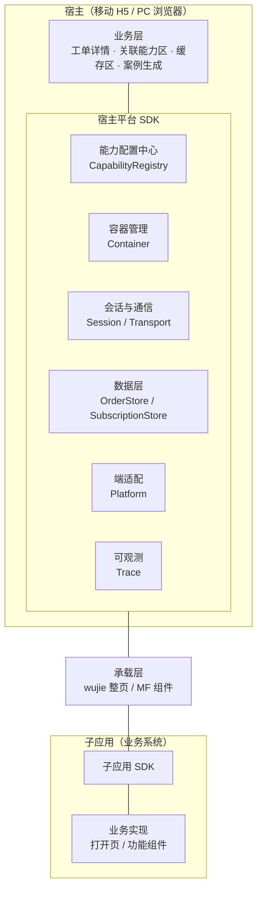
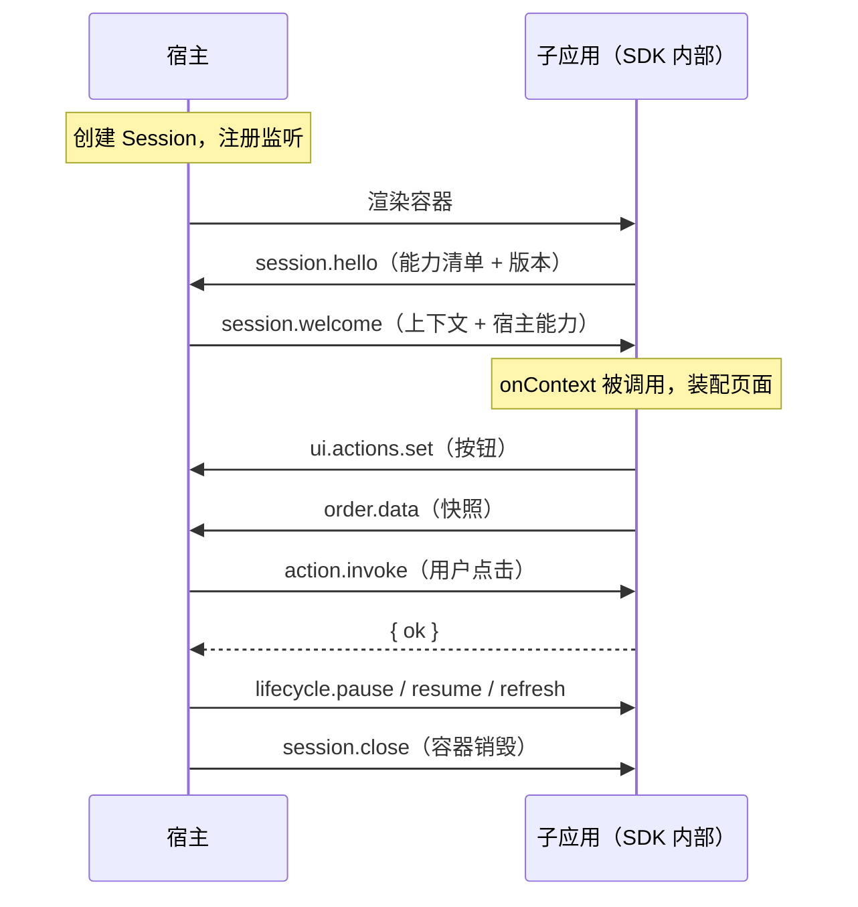

# 统一待办 · 前端设计方案（v2.0）

> **本版说明**：不受技术验证 demo 与既有方案文档约束的重新设计；demo 与旧文档仅作参考。不包含迁移路径。
> **取舍倾向**：工程架构与接入体验两者都要，**以接入体验优先**——架构优雅为接入门槛让路。
> **技术栈**：宿主 React 19；移动端为纯 H5（在安卓 / iOS / 鸿蒙 App 的 WebView 内承载，原生桥不在本方案范围）；PC 端为独立浏览器应用。
> **范围**：子应用接入平台（协议、SDK、容器）+ 宿主侧所需的数据契约与业务接口。统一待办的产品页面与业务流不在本次。

---

## 1. 设计目标与成功标准

### 1.1 目标

| # | 目标 | 成功标准 |
|---|---|---|
| 1 | **接入体验优先** | 子应用方「零协议知识」接入：不写任何消息名、不处理重试/幂等/归属校验 |
| 2 | **一次接入，多端运行** | 同一子应用产物在移动 H5 与 PC 浏览器都可用，无分支代码 |
| 3 | **双形态统一语义** | 整页嵌入与功能组件对宿主暴露**同一套能力模型**，宿主代码不区分来源 |
| 4 | **渐进接入** | 子应用可只声明部分能力先上线，缺能力时宿主自动降级、不报错 |
| 5 | **失败可解释** | 任一环节超时/失败都能定位到「谁在哪一步没响应」，且有明确降级表现 |
| 6 | **协议可演进** | 协议版本化；语义稳定；新增不破坏、废弃有过渡 |
| 7 | **可观测** | 一次交互可回放；关键耗时可度量 |

### 1.2 非目标

- 不统一各业务系统的后端数据模型，只约定**对外暴露层**。
- 不做产品功能设计（列表、详情、缓存区 UI、案例生成流程）。
- 不包含原生桥能力（拍照 / 扫码 / 推送 / 文件）——仅预留接口位。
- 不替代既有工单 SSO。

### 1.3 三条设计原则

1. **接入方只写业务**：协议、时序、幂等、归属校验、资源释放全部下沉到 SDK。
2. **语义优于消息**：对外暴露「取工单数据」「执行动作」这类语义，而不是消息名字符串。
3. **失败是一等公民**：每个请求都有超时、重试与降级路径，并在设计期写清「超时后用户看到什么」。

---

## 2. 产品与场景边界

### 2.1 用户旅程（关联能力的位置）

```
待办列表 → 打开工单详情
              ├─ 工单基本信息（宿主自有）
              ├─ 关联能力区 ← 本方案的接入面
              │     ├─ 整页嵌入：业务系统的工单视图
              │     └─ 功能组件：单一能力（如小区状态）
              ├─ 订阅缓存区（数据契约，UI 不在本次）
              └─ 案例生成（消费缓存数据，UI 不在本次）
```

### 2.2 三个角色

| 角色 | 职责 | 本方案覆盖 |
|---|---|---|
| **宿主**（统一待办） | 工单入口、容器渲染、能力编排、数据汇聚 | ✅ 平台 SDK + 数据契约 |
| **子应用**（业务系统） | 提供工单视图 / 单一能力 | ✅ 接入 SDK + 接入指南 |
| **配置服务** | 下发能力清单、灰度规则 | ✅ 契约（接口形态见 §6.2） |

### 2.3 边界约定

- **身份**：沿用工单 SSO；宿主票据换取子应用自身 token，前端只传递不解释。
- **数据权威**：工单业务数据以**业务系统**为权威源；宿主只持有其对外暴露的快照。
- **UI 权威**：宿主负责容器、导航、操作栏；子应用负责容器内的内容。

---

## 3. 总体架构

### 3.1 分层



### 3.2 各层职责

| 层 | 职责 | 明确不负责 |
|---|---|---|
| 业务层 | 展示与编排 | 通信细节、端差异、错误重试 |
| 宿主平台 SDK | 配置、容器、会话、数据、端适配、可观测 | 业务字段语义 |
| 承载层 | 把子应用挂进宿主（wujie / MF） | 协议解释 |
| 子应用 SDK | 就绪、上下文、能力声明、数据/动作回调、资源释放 | 协议细节 |
| 业务实现 | 业务本身 | 通信、宿主 UI |

### 3.3 核心思想：双形态，同一能力模型

子应用有两种接入形态，但对宿主暴露**完全相同的能力接口**：

| 形态 | 适用 | 承载 |
|---|---|---|
| **整页嵌入** | 技术栈不确定 / 有历史包袱的既有系统 | wujie（沙箱 + Shadow DOM） |
| **功能组件** | 新建能力（无历史包袱） | Module Federation（运行在宿主 React 树内） |

宿主只看「这个功能声明了哪些能力」，**不写 `if (整页)` 分支**。这是本方案最重要的一条架构决策。

---

## 4. 接入模型

### 4.1 能力模型（Capability）

子应用显式声明能力，宿主据此决定渲染什么：

```ts
type Capability =
  | 'ui.actions'      // 提供底部动作按钮
  | 'order.data'      // 提供工单数据快照
  | 'order.stream'    // 提供持续数据（订阅）
  | 'lifecycle'       // 响应 pause / resume / refresh
  | 'notify';         // 发出 toast / 关闭 / 跳转请求
```

**价值**：
- 老系统可**只声明 `ui.actions`** 先上线，其余能力后补；
- 宿主对缺能力的功能**自动隐藏对应入口**，不报错；
- 灰度可按能力维度渐进开放。

### 4.2 整页嵌入的接入面（6 个回调）

```ts
import { createEntryApp } from '@ut/sub-sdk';

export default createEntryApp({
  name: 'alert-order',
  capabilities: ['ui.actions', 'order.data', 'lifecycle', 'notify'],

  // 上下文下发后装配页面
  onContext: async (ctx) => { /* ctx: { orderId, orderType, ui, ... } */ },

  // 底部动作按钮
  getActions: () => [
    { key: 'urge', label: '追单', primary: true },
    { key: 'suspend', label: '挂起' },
  ],

  // 工单数据快照
  getOrderData: () => ({
    status: 'processing',
    statusText: '处理中',
    fields: [
      { label: '处理人', value: '张伟' },
      { label: '更新时间', value: '今天 10:45' },
    ],
  }),

  // 响应宿主点击
  onAction: async (key) => ({ ok: true }),

  // 生命周期
  onPause: () => stopPolling(),
  onResume: () => { resumePolling(); refresh(); },
  onRefresh: () => refresh(),

  // 通知（可选）
  notify: {
    toast: (text) => showToast(text),
    close: () => closeSelf(),
    navigate: (route) => go(route),
  },
});
```

SDK 内部负责：就绪声明与重试、`appName` 过滤、幂等与序号、归属校验、监听成对释放、独立运行分支、协议版本协商、资源释放。

### 4.3 功能组件的接入面（1 个工厂）

```tsx
import { createFeatureComponent } from '@ut/sub-sdk';

export default createFeatureComponent({
  name: 'cell-status',
  capabilities: ['order.stream', 'ui.actions'],

  Component: ({ ctx, emit }) => { /* React 19 组件 */ },

  getOrderStream: (ctx) => ({          // 可选：持续数据
    subscribe: (push) => { /* 内部轮询/长连接 */ return () => stop(); },
  }),

  getActions: () => [...],
  onAction: async (key) => ({ ok: true }),
});
```

组件运行在宿主 React 19 树内，因此**必须使用 React 19 且共享同一实例**（MF singleton）。

### 4.4 生命周期



---

## 5. 通信与数据契约

### 5.1 三层通信模型

| 层 | 职责 | 形态 |
|---|---|---|
| **Transport** | 投递与去重，屏蔽 wujie bus / postMessage / MF 内部桥的差异 | `send` / `onMessage` / `close` |
| **Session** | 握手、能力协商、请求超时与重试、幂等、心跳、版本协商 | `request` / `emit` / `on` |
| **语义** | 两类：请求-响应 与 事件 | 语义名（如 `order.get`） |

**为什么不用裸事件总线**：裸总线无队列、无确认、无重放，会导致每个接入方重写一遍「握手 + 重试 + 幂等 + 归属校验」的补丁。本方案把这些收敛到 Session 层，接入方零感知。

### 5.2 消息信封

```ts
interface Envelope {
  v: number;                       // 协议版本
  id: string;                      // traceId，贯穿一次交互
  seq: number;                     // 会话内单调递增
  ts: number;
  from: { app: string; role: 'host' | 'sub' };
  to:   { app: string; role: 'host' | 'sub' } | '*';
  kind: 'req' | 'res' | 'evt';
  topic: string;
  payload?: unknown;
  idempotentKey?: string;
}
```

所有消息带 `from.app`，接收方按 `app` 过滤（多子应用共存不串消息）。

### 5.3 语义目录

**请求-响应**

| topic | 方向 | 请求 | 响应 |
|---|---|---|---|
| `order.get` | 宿 → 子 | `{ orderId? }` | `OrderSnapshot` |
| `ui.actions.get` | 宿 → 子 | — | `ActionDescriptor[]` |
| `action.invoke` | 宿 → 子 | `{ key, args? }` | `{ ok, message? }` |
| `session.open` | 宿 → 子 | `WorkOrderContext` | `Capabilities` |

**事件**

| topic | 方向 | payload |
|---|---|---|
| `ui.actions.set` | 子 → 宿 | `ActionDescriptor[]`（空数组=清空） |
| `order.data` | 子 → 宿 | `OrderSnapshot` |
| `order.stream` | 子 → 宿 | `StreamChunk`（订阅式持续数据） |
| `lifecycle.pause` / `resume` / `refresh` | 宿 → 子 | — |
| `notify.toast` / `notify.close` / `notify.navigate` | 子 → 宿 | 各自载荷 |
| `session.hello` / `session.welcome` / `session.close` | 双向 | 会话层 |

> 会话层消息不进业务语义目录，由 SDK 内部处理。

### 5.4 数据模型

```ts
/** 宿主 → 子应用 */
interface WorkOrderContext {
  orderId: string;
  orderType: string;
  tenant?: string;
  ui?: { theme?: 'light' | 'dark'; locale?: string; safeAreaBottom?: number };
  features?: Record<string, boolean>;     // 宿主能力开关
}

/** 子应用 → 宿主 */
interface OrderSnapshot {
  orderId: string;                        // 必须回带，宿主据此校验归属
  updatedAt: number;                      // 单调，宿主据此去旧
  status?: string;
  statusText?: string;
  title?: string;
  fields?: Array<{ key?: string; label: string; value: string }>;
  actions?: ActionDescriptor[];
}

interface ActionDescriptor {
  key: string;
  label: string;
  primary?: boolean;
  icon?: string;
  disabled?: boolean;
}

/** 展示规范：条数无上限（宿主整体渲染）、字段不可点击（纯展示） */
interface Field { key?: string; label: string; value: string }
```

### 5.5 错误与超时模型

```ts
interface ProtocolError {
  code: 'TIMEOUT' | 'NOT_SUPPORTED' | 'INVALID_PAYLOAD' | 'REJECTED' | 'INTERNAL';
  message: string;
  traceId: string;
}
```

| 场景 | 处理 |
|---|---|
| 请求超时 | 指数退避重试（2/4/8s，最多 3 次），仍失败抛 `TIMEOUT` |
| 对端不支持 | 能力协商阶段即不可用，调用方走降级分支，不发请求 |
| 载荷不合法 | dev 打 schema mismatch 警告；prod 丢弃并上报埋点 |
| 重复请求 | 按 `idempotentKey` 去重，返回首次结果 |

### 5.6 订阅数据契约（缓存区，仅契约）

> 缓存区 UI 与业务流不在本次；这里只定义**数据契约与宿主侧接口**。

```ts
interface SubscriptionItem {
  subId: string;          // `${appName}:${entityType}:${orderId}:${businessKey}`
  entityType: string;
  businessKey: string;
  title: string;
  tag: string;            // 落到缓存区哪个分类
  summary: string;
  data: unknown;
  status: 'snapshot' | 'live';   // 快照 / 持续更新
  updatedAt: number;
  version: number;
}

interface SubscriptionStore {
  upsert(item: SubscriptionItem): void;      // 归属校验 + 去旧 + 整体替换
  remove(subId: string): void;
  list(filter?: { orderId?: string; tag?: string }): SubscriptionItem[];
  onChanged(cb: (items: SubscriptionItem[]) => void): () => void;
}
```

**宿主侧语义**：
- `live` 项在**离开工单时结束**；宿主删除条目等价于退订（由 SDK 下发 `subscription.cancel`）；
- `subId` 由**宿主**构造，子应用只提供 `entityType` + `businessKey`；
- 案例生成消费 `list()` 的选中项。

---

## 6. 宿主设计

### 6.1 包结构

```
packages/host-sdk/
  ├── registry/      CapabilityRegistry     能力配置中心
  ├── container/     Container              容器（drawer/inline/modal，三态，降级）
  ├── session/       Session, Transport     会话与通信
  ├── store/         OrderStore, SubscriptionStore
  ├── platform/      Platform               端适配
  └── observability/ Trace, Metrics
```

### 6.2 能力配置中心 `CapabilityRegistry`

```ts
interface RemoteFunc {
  id: string;                        // 稳定标识 `{appName}_{featureName}`
  icon: string;
  title: string;
  desc: string;
  entry:
    | { kind: 'page'; url: string }           // 整页嵌入（wujie）
    | { kind: 'component'; module: string };  // 功能组件（MF 模块标识）
  container: { type: 'drawer' | 'inline' | 'modal'; position?: string };
  capabilities: Capability[];        // 期望能力，用于灰度与降级判断
  cache?: { mode: 'none' | 'snapshot' | 'live' };
  audience?: { env?: string[]; users?: string[]; percentage?: number };
}

class CapabilityRegistry {
  async load(orderType: string): Promise<RemoteFunc[]>;
  onRefresh(cb: (funcs: RemoteFunc[]) => void): () => void;   // 配置热更新
}
```

**配置服务契约（REST）**：`GET /api/capabilities?orderType=&user=&env=` → `RemoteFunc[]`；支持 ETag 缓存；热更新用**轮询**实现（暂不引入 SSE）。

### 6.3 容器 `Container`

```tsx
<CapabilityContainer
  func={func}
  open={open}
  context={{ orderId, orderType }}
  onClose={...}
/>
```

| 能力 | 说明 |
|---|---|
| 三态 | `loading` / `ready` / `error`；error 必须给出**重试入口** |
| 双形态 | `entry.kind === 'page'` → wujie 容器；`'component'` → MF 懒加载容器。**业务层不感知差异** |
| 降级 | wujie 内核能力不足时自动转 iframe；MF 加载失败退化为静态提示 |
| 保活 | `alive` 时容器关闭只隐藏，保留会话与数据；**按工单管理**：离开工单即释放该工单下所有容器与会话 |
| 端呈现 | 移动：底部抽屉（含安全区）；PC：侧滑 / 居中弹窗；由 `position` 与端实现决定 |
| 埋点 | 每次打开 / 关闭 / 失败 / 重试都带 `traceId` 上报 |

### 6.4 数据层

```ts
class OrderStore {
  accept(snapshot: OrderSnapshot): void;   // 归属校验 + 去旧 + 整体替换
  get(orderId: string): OrderSnapshot | null;
  onOrderChanged(cb): () => void;
}
```

**归属校验内建**：`snapshot.orderId !== 当前工单` 直接丢弃；`updatedAt` 较旧的丢弃。这是保活模式下最容易串数据的地方，必须在 SDK 层强制，不允许业务代码自己判断。

### 6.5 端适配 `Platform`

```ts
interface Platform {
  kind: 'mobile' | 'pc';
  onVisibilityChange(cb: (visible: boolean) => void): () => void;
  safeArea: { top: number; bottom: number };
  viewport: { width: number; height: number };     // dvh 语义
  onFontReady(cb: () => void): () => void;
  network?: { online: boolean; type?: string };    // 弱网提示用
  native?: NativeBridge;                           // 预留，本方案不实现
}
```

**要点**：业务代码不直接监听 `visibilitychange`、不写 `env(safe-area-inset-*)`、不写 `100vh`。字体与图标**自托管**由构建层保证。

### 6.6 可观测 `Trace`

- 每次交互生成 `traceId`，贯穿 request / event / 渲染。
- 时间线：`session.hello` 耗时、`order.get` 耗时、`action.invoke` 耗时、容器打开到首次可见耗时。
- 指标：握手耗时 P95、首次可见 P95、指令成功率、数据上报延迟、降级发生率。
- 埋点输出为**接口**（`Metrics.report(event, data)`），不绑定具体平台。

---

## 7. 子应用设计

### 7.1 接入面总结（接入体验优先的核心）

| 形态 | 接入方要写的 | 接入方不写的 |
|---|---|---|
| 整页嵌入 | 一个 `createEntryApp({...})` + 6 个回调 | 消息名、握手、重试、幂等、归属校验、`$on/$off`、独立运行分支、协议版本 |
| 功能组件 | 一个 `createFeatureComponent({...})` + 组件 + 可选流式数据 | 同上 |

**协议知识为零**：接入方代码里不出现任何 `session.*` / `order.*` 字符串。

### 7.2 打开页契约（整页嵌入）

| 项 | 要求 |
|---|---|
| 路径 | 统一规则（建议 `/entry/{appName}`） |
| 独立可访问 | 必须（降级与排障依赖） |
| 无自身导航 / 底栏 | 必须（由宿主渲染） |
| url 参数 | 仅承载初始上下文与票据；其余走 `onContext` |
| 能力声明 | 显式；缺省即视为不支持 |
| 资源路径 | 相对路径 |
| 保活 | 不得依赖「每次都被重新创建」 |
| 存储 | 自身 key 加应用前缀 |

### 7.3 功能组件契约（MF）

| 项 | 要求 |
|---|---|
| React 版本 | **React 19**，与宿主共享同一实例（MF singleton） |
| 暴露方式 | `export default`，由 `createFeatureComponent` 包装 |
| 样式 | 局部作用域；禁止全局选择器与 `position: fixed` |
| 数据 | 组件自取（携带上下文），或由 `getOrderStream` 提供 |
| 资源 | 部署 `remoteEntry.js` + `mf-manifest.json` 同目录，CORS 可访问 |

### 7.4 独立运行与降级

- 无宿主环境（`window.$wujie` 不存在 / 非 MF 容器）→ SDK 自动切独立模式，打开页仍可运行。
- 能力协商结果缺某能力 → 宿主隐藏对应入口。
- wujie 自动降级（内核能力不足）→ SDK 无感，行为一致。

### 7.5 资源释放

```ts
const app = createEntryApp({...});
app.dispose();   // 容器卸载时 SDK 自动调用
```

所有注册必须可释放；`pause` 后不得残留定时器与长连接。

---

## 8. 多端设计

| 维度 | 移动 H5（WebView） | PC 浏览器 |
|---|---|---|
| 宿主形态 | 独立应用 | 独立应用 |
| 容器呈现 | 底部抽屉（`h ≈ 66%`，含安全区） | 侧滑抽屉 / 居中弹窗 |
| 端差异 | 安全区、dvh、前后台、字体自托管 | 视口、键盘快捷键 |
| 共享 | `@ut/host-sdk`、`@ut/container`、`@ut/protocol` 全部共享 | 同左 |

**关键**：两端共享同一份 SDK 与容器组件，差异收敛在 `Platform` 与容器的呈现参数。业务层代码两端一致。

> PC 端与移动端共用同一数据模型（`OrderSnapshot` / `WorkOrderContext`）。

---

## 9. 非功能设计

### 9.1 性能

| 项 | 策略 |
|---|---|
| 首屏 | ≤ 2s（资源已缓存）；关联能力区**非首屏阻塞项**，可延迟渲染 |
| 保活 | **按工单管理**：同工单内容器保活，离开工单统一释放 |
| 预热 | 仅在上下文与票据就绪后预热；默认只预取资源，预执行按功能显式开启 |
| 包大小 | 宿主首包 ≤ 200KB（gzip）；关联能力相关代码按需加载 |
| 渲染 | 容器动画避免 `transform` 影响子应用 `position: fixed`（实测项） |

### 9.2 安全

| 项 | 策略 |
|---|---|
| 票据 | 一次性、短时效，换取后失效；不进日志/埋点/url 长期留存 |
| 域名 | 子应用域名白名单；CSP 收敛 |
| 存储 | 宿主自身 key 统一前缀（`todo:`） |
| 跨应用 | 禁止 `window.parent` 直连；统一走 Transport |
| 信任边界 | MF 远程模块是可执行 JS，接入方与宿主须互信；建议构建期校验 |

### 9.3 兼容与灰度

- **协议版本化**：`session.open` 时协商 `v`；语义稳定，新增不破坏，废弃走过渡期。
- **能力协商**：缺能力自动降级，是渐进接入的基础。
- **配置灰度**：`audience` 支持按环境 / 用户 / 百分比。
- **双发期**：语义变更期间新旧同时发，一个版本后移除旧的。

### 9.4 可观测与排障

- `traceId` 贯穿一次交互，可回放时间线。
- 关键埋点：握手耗时、首次可见、指令成功率、数据上报延迟、降级发生。
- 排障入口：宿主调试面板（时间线视图）+ 接入自检工具（见 §10）。

---

## 10. 工程结构与交付物

### 10.1 Monorepo

```
packages/
  protocol/        # 协议与类型（唯一事实来源）：Envelope、语义目录、数据模型、schema
  host-sdk/        # 宿主平台 SDK
  sub-sdk/         # 子应用侧 SDK
  container/       # 容器 UI（drawer/inline/modal，移动 + PC）
  platform/        # 端适配
  check/           # 接入自检 CLI（见 10.3）
apps/
  mobile-host/     # 移动 H5 宿主
  pc-host/         # PC 宿主
examples/
  entry-page/      # 整页嵌入最小示例
  feature-component/  # 功能组件最小示例
docs/              # 本方案、接入指南（整页 / 组件两份）、协议
```

**`protocol` 包是唯一事实来源**：类型、语义名、schema 都在此定义，SDK 与文档从它派生；业务代码禁止手写消息名字符串。

### 10.2 交付物

| 交付物 | 说明 |
|---|---|
| `@ut/protocol` | 协议类型与校验器 |
| `@ut/host-sdk` / `@ut/sub-sdk` | 两端 SDK |
| `@ut/container` | 容器组件 |
| `@ut/check` | 接入自检 CLI |
| 接入指南 | 整页版 + 组件版，各 ≤ 2 页 |
| 示例工程 | 两个最小示例，可直接跑 |
| 验收清单 | 见附录 B |

### 10.3 接入自检（接入体验的关键）

`npx @ut/check` 在接入方仓库本地运行，校验：

- 能力声明与实际回调一致（声明了 `order.data` 却没实现 `getOrderData` → 报错）
- 打开页可独立访问、无自身导航/底栏
- 资源路径为相对路径
- MF 模块：React 19 + singleton、`export default`、`mf-manifest.json` 可访问
- 样式违规：全局选择器、`position: fixed`
- 存储 key 是否加前缀

**输出**：一份通过/失败清单 + 修复建议。把「接入是否合格」变成一次本地命令，而不是联调时才发现。

---

## 附录 A：能力目录

| 能力 | 语义 | 整页嵌入 | 功能组件 | 宿主表现 |
|---|---|---|---|---|
| `ui.actions` | 提供底部动作按钮 | ✅ | ✅ | 宿主底部栏渲染，>4 个折叠 |
| `order.data` | 工单数据快照 | ✅ | ✅ | 宿主展示关键字段 |
| `order.stream` | 持续数据（订阅） | ✅ | ✅ | 写入 SubscriptionStore |
| `lifecycle` | pause/resume/refresh | ✅ | ✅ | 前后台与刷新协同 |
| `notify` | toast/close/navigate | ✅ | ✅ | 宿主统一提示与跳转 |

---

## 附录 B：接入自检清单

**协议**
- [ ] `session.hello` 带能力清单与协议版本
- [ ] 未收到 `session.welcome` 时按指数退避重试
- [ ] 上报 `ui.actions.set`；变化时重发；空数组清空
- [ ] 上报 `order.data`，**回带 `orderId`**；变化时重发
- [ ] 响应 `action.invoke`，返回 `{ ok }`
- [ ] 响应 `lifecycle.pause` / `resume` / `refresh`，`resume` 后立即拉取

**工程**
- [ ] 打开页可独立访问，无自身导航 / 底栏
- [ ] 独立运行分支：无宿主环境时不报错
- [ ] 监听成对释放；`pause` 后无残余定时器
- [ ] 未直接访问 `window.parent`
- [ ] 资源相对路径；存储 key 加前缀

**MF 专属**
- [ ] React 19 + `react`/`react-dom` singleton
- [ ] `export default`；`mf-manifest.json` 与 `remoteEntry.js` 同目录可访问
- [ ] 无全局选择器；无 `position: fixed`

---

## 附录 C：待确认事项

**已确认（2026-10-16）**：① 配置服务用 **REST**，热更新走轮询；② `OrderSnapshot.fields` **条数无上限、不可点击**；③ 保活**按工单管理**（离开工单统一释放）。

| # | 事项 | 影响 |
|---|---|---|
| 1 | `order.stream` 的背压与频率上限 | 订阅式数据的性能 |
| 2 | 原生桥 `NativeBridge` 接口形态（本次不实现，仅预留） | 后续扩展 |
| 3 | PC 端容器的具体形态（侧滑 vs 居中的默认值） | 多端一致性 |
